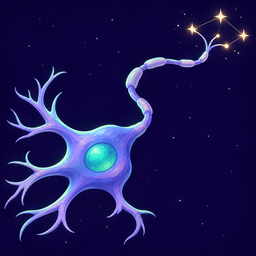
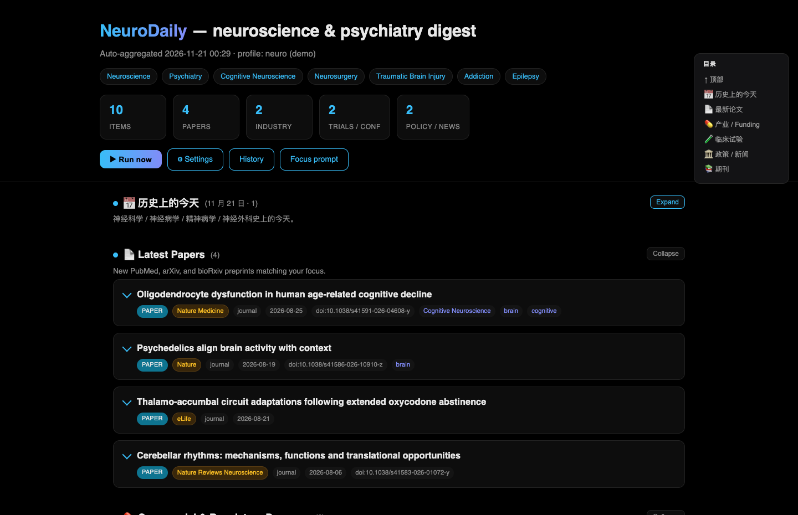
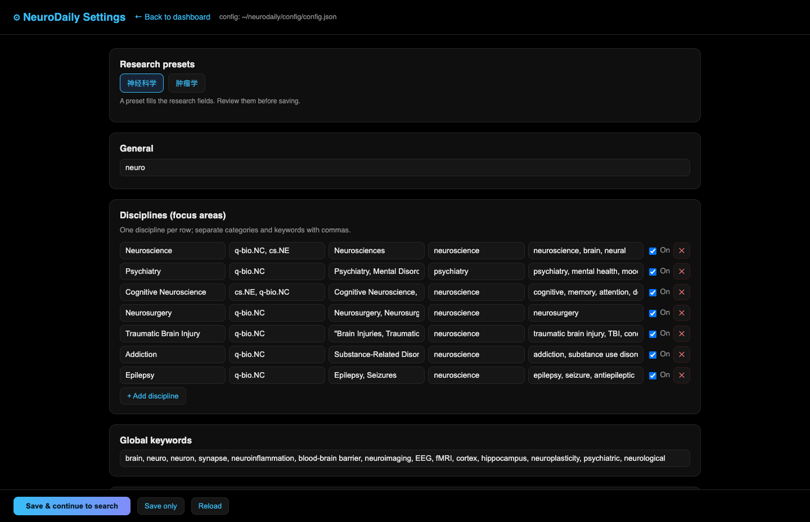

<p align="center">
  
</p>

# 神通寰宇 · NeuroDaily

**用一份可追溯的日报，跟进领域内每天的进展。**

NeuroDaily 适合需要持续跟踪论文、预印本、临床试验和监管产业动态的研究者。把检索规则保存为研究配置，手动或定时生成 HTML 日报，按需通过邮件、飞书或企业微信分享。内置神经科学、肿瘤学与重症医学预设，界面默认中文，可在设置中切换英语和俄语。

[macOS 安装](docs/MACOS_HOMEBREW.md) · [下载 Windows / Linux 版](https://github.com/Koalalive/neurodaily/releases/latest) · [运行离线演示](#快速开始) · [GitHub Actions 手册](docs/GITHUB_ACTIONS.md) · [竞品对照与接口路线](docs/ROADMAP.md)

[中文](#中文) · [English](#english) · [Русский](#русский)

[](https://github.com/Koalalive/neurodaily/actions/workflows/ci.yml)

[](LICENSE)

[项目主页](https://koalalive.github.io/neurodaily/)提供安装入口、界面演示和文档索引。

## 界面预览 · Screenshots

下图为本地运行的日报演示。打开本机工作区后，从设置选择学科并发起检索，可在独立标签页浏览新日报和最近一次结果。



<details>
<summary>查看设置页 · Desktop settings</summary>



</details>

---

## 中文

## 目录

- [核心特性](#核心特性)
- [快速开始](#快速开始)
- [GitHub Actions](docs/GITHUB_ACTIONS.md)
- [竞品对照与接口路线](docs/ROADMAP.md)
- [Docker](#docker)
- [配置](#配置)
- [检索策略配置设计](docs/SEARCH_STRATEGY.md)
- [AI 每日摘要（可选）](#ai-每日摘要可选)
- [学科 profile 与 Agent 配置](#学科-profile-与-agent-配置)
- [邮件与 Webhook](#邮件与-webhook)
- [数据源](#数据源)
- [自定义 RSS 订阅源](#自定义-rss-订阅源)
- [命令行](#命令行)
- [HTTP API](#http-api)
- [项目结构](#项目结构)
- [测试](#测试)
- [文档](#文档)
- [免责声明](#免责声明)

---

## 核心特性

| 能力 | 说明 |
|---|---|
| **七源聚合** | 期刊 RSS · PubMed · arXiv · bioRxiv · ClinicalTrials.gov · openFDA · 政策/新闻 |
| **创投/产业情报** | BCI 融资、neurotech 融资、MedTech Dive、Crunchbase（`kind=funding`） |
| **AI 每日摘要** | 按需概述研究、临床监管和产业动态，摘要引用回到原始条目。可关闭，结果带缓存 |
| **历史上的今天** | 936 篇约千字学科史长文，按日轮换，精确日/近邻/经典标注 |
| **交互式日报** | 离线研究地图、各来源状态和外部引用图谱入口 |
| **API 账单** | 按次记录模型用量和估算费用，可配置费率与 AI 地理定位。 [用法与商用许可](docs/RESEARCH_ACTIVITY.md) |
| **工作区标签页** | 设置、运行历史和新检索日报各自保留，返回仪表盘可打开最近一份真实日报 |
| **邮件日报** | 可设定发送时间、正文条目数和完整 HTML 附件，支持多个收件人 |
| **任务与投递记录** | 查看各来源进度和已完成任务，选中失败渠道单独重试 |
| **桌面通知** | macOS / Linux 原生通知 |
| **Web 设置页 + TUI** | 收件人、SMTP 凭据、关注点、定时任务；无需手改 JSON |
| **Agent 可配置** | JSON 补丁 + schema 校验 + dry-run + profile；换学科零代码 |
| **配置化数据源** | 填一个 RSS/JSON 地址即可新增源，不写 Python |
| **导出** | JSON / BibTeX |
| **Webhook** | 飞书 / 企业微信 |
| **离线演示** | `neurodaily demo`，断网可完整演示 |
| **检索质量对比** | 在同一批标注论文上比较规则、查看召回率和前 K 条准确率 |
| **稳健性** | 并行抓取、0 条自动回退、单源失败降级、报告保留策略 |
| **可部署** | `scripts/start.sh` 一键启动；Docker / docker compose（镜像约 199MB） |

---

## 快速开始

macOS 可用 Homebrew tap 安装，通过浏览器打开本机工作区。Windows 和 Linux 从 [GitHub Releases](https://github.com/Koalalive/neurodaily/releases/latest) 下载安装包。打开工作区后可选择学科、语言和推送方式，开始检索后在新标签页查看日报。服务器或 CI 可使用 CLI。 [GitHub Actions 手册](docs/GITHUB_ACTIONS.md)

### macOS（Homebrew）

安装 Homebrew 后，在终端运行以下命令。

```bash
brew tap koalalive/neurodaily https://github.com/Koalalive/neurodaily.git
brew install koalalive/neurodaily/neurodaily
neurodaily web
```

服务默认在 `http://127.0.0.1:8031/desktop` 打开浏览器。可用 `neurodaily web --no-open` 只启动服务。终端中的 **Ctrl+C** 会停止定时检索和推送。升级使用 `brew update && brew upgrade koalalive/neurodaily/neurodaily`。 [完整安装与升级说明](docs/MACOS_HOMEBREW.md)

### 本地（Python 3.12+）

```bash
git clone https://github.com/Koalalive/neurodaily.git
cd neurodaily

python3 -m venv .venv
.venv/bin/pip install -e .

.venv/bin/python -m neurodaily config init     # 写入默认 config/config.json
.venv/bin/python -m neurodaily run             # 跑一次，生成 output/*.html
```

一键启动 Web 应用（含设置页）：

```bash
scripts/start.sh
# http://127.0.0.1:8031
```

### 从源码一键启动（macOS）

双击 `scripts/启动 NeuroDaily.command` → 自动启动服务并打开设置页。

日报页上的 **设置** 可修改推送、检索窗口和界面语言。**立即检索** 打开运行页，可直接使用已保存配置，也可以为本次检索临时指定时间范围。

离线演示（不联网）：

```bash
.venv/bin/python -m neurodaily demo --no-open
```

### Docker

```bash
docker build -t neurodaily:local .
docker run -d --name neurodaily -p 127.0.0.1:8031:8031 neurodaily:local
# http://127.0.0.1:8031
```

或：

```bash
docker compose up --build
```

详见 [`docs/DOCKER.md`](docs/DOCKER.md)。

### Windows 和 Linux 安装包（Tauri 2 + Python sidecar）

安装对应系统的桌面应用即可运行。

| 平台 | 安装包 | 架构 |
|---|---|---|
| Windows | `.msi` / `.exe` | x86_64 |
| Linux | `.AppImage` / `.deb` | x86_64 |

安装包从 GitHub Releases 下载；具体系统要求见
[`docs/INSTALL_REQUIREMENTS.md`](docs/INSTALL_REQUIREMENTS.md)。

在 Linux 上从源码构建：

```bash
bash desktop/build_sidecar.sh
cd desktop/tauri && npm install && npm run icon && npx tauri build
```

架构、签名、CI 矩阵与排障见 [`docs/DESKTOP_TAURI.md`](docs/DESKTOP_TAURI.md)。

---

## 配置

配置文件：`config/config.json`（gitignored）。查看/校验：

```bash
.venv/bin/python -m neurodaily config show
.venv/bin/python -m neurodaily config validate
.venv/bin/python -m neurodaily config describe     # Agent 可读的能力清单
.venv/bin/python -m neurodaily config schema --out schema.json
```

完整字段说明见 [`docs/CONFIGURATION.md`](docs/CONFIGURATION.md)。

**最常改的三件事**

```jsonc
{
  "disciplines": [ { "name": "Epilepsy", "mesh_terms": ["Epilepsy"], "keywords": ["seizure"] } ],
  "sources": { "pubmed": { "enabled": true, "max_results": 500, "lookback_days": 2 } },
  "journals": [ { "name": "Neuron", "rss": "https://www.cell.com/...", "category": "neuroscience" } ]
}
```

---

## AI 每日摘要（可选）

需要用户自己的 OpenAI 兼容 API key（默认 DeepSeek）：

```bash
printf '%s' 'sk-...' > ~/.neurodaily_deepseek && chmod 600 ~/.neurodaily_deepseek
cp config/ai_summary.example.json config/ai_summary.json
.venv/bin/python -m neurodaily ai-summary --demo --force --save   # 预览
```

- 位置：报告**最顶部**（在「历史上的今天」之上），并写入邮件正文
- 缓存：同日同内容不重复调用（`output/ai_summary/`）
- 失败只降级，不影响报告生成与投递
- 提示词强制「不得编造日期/数字/人名/结论」

---

## 学科 profile 与 Agent 配置

为非默认学科单独建配置，不动主配置：

```bash
.venv/bin/python -m neurodaily profile new oncology
.venv/bin/python -m neurodaily config apply config/examples/oncology.patch.json --profile oncology --dry-run
.venv/bin/python -m neurodaily config apply config/examples/oncology.patch.json --profile oncology
.venv/bin/python -m neurodaily --profile oncology demo --no-open
```

补丁语义：**对象递归合并、数组整体替换、`null` 删除**。
非技术用户可以让 Agent 按 [`docs/AGENT_GUIDE.md`](docs/AGENT_GUIDE.md) 的协议完成换学科。

### Profile 导出 / 导入 / 体检

Profile 是**单个可迁移 JSON**（`format: neurodaily.profile`），不含邮件/AI 密钥和本机输出设置：

```bash
# 导出当前 profile（或指定 profile）
.venv/bin/python -m neurodaily profile export neuro -o neuro.profile.json

# 先校验，再导入为独立 profile
.venv/bin/python -m neurodaily profile validate neuro.profile.json
.venv/bin/python -m neurodaily profile import neuro.profile.json --name neuro-copy

# 离线体检：schema、source type/url、期刊、检索表达式
.venv/bin/python -m neurodaily profile doctor neuro-copy
```

- `import` 默认 `--mode merge`，保留本机 `output/scheduled` 等私有设置；`--mode replace` 只保留共享检索配置
- `--dry-run` 只校验/预览，不写文件
- 设置页的“导出已保存的配置 / 导入配置文件”使用同一套 `profile_exchange` 逻辑

---

## 主题景观（可选，LDA + t-SNE）

在 `world map` 之后可生成一个交互式主题景观：

- 中英文混合分词
- LDA 文档-主题分布
- t-SNE 二维投影
- LLM 为每个主题生成短标签
- 每个点可点开查看标题、来源、日期、主题和原文链接

本地启用：

```bash
.venv/bin/pip install -e ".[topics]"
```

Tauri sidecar 构建脚本会安装 `scikit-learn` 并将其打包；若不需要主题图，可保持轻量基础包。关闭：

```json
"output": {"topic_map": false}
```

`topic_map.py` 不把完整摘要塞进报告 JSON，只保留投影、主题和短摘要，避免报告体积失控。

## 邮件与 Webhook

邮件（`config/email.json`）：

```bash
cp config/email.example.json config/email.json
printf '%s' '你的SMTP授权码' > ~/.neurodaily_smtp && chmod 600 ~/.neurodaily_smtp
.venv/bin/python -m neurodaily mail --test
.venv/bin/python -m neurodaily mail --send            # 立即跑一次并发送
.venv/bin/python -m neurodaily mail --send-latest     # 复用上次渲染重发
.venv/bin/python -m neurodaily mail --tui             # 收件人/凭据 TUI
```

- 主题模板：`神经病专家的厕所读物-{date} {weekday}`
- 正文：AI 摘要 + 历史上的今天 + 前 12 篇论文 + 其他板块计数
- 附件：完整 HTML 报告（`attach_max_mb` 超限自动跳过）

Webhook（`config/webhooks.json`）：

```bash
cp config/webhooks.example.json config/webhooks.json
.venv/bin/python -m neurodaily webhook --test
```

---

## 数据源

内置（`sources/*.py`）：`journal`、`arxiv`、`pubmed`、`biorxiv`、`fda_drugs`、`fda_devices`、`trials`、`policy`。

**配置化数据源**（不写代码）：

```json
{
  "sources": {
    "nci_news": { "type": "rss", "url": "https://...", "kind": "news",
                  "max_results": 30, "lookback_days": 7, "enabled": true },
    "my_api":   { "type": "json_api", "url": "https://...", "items_path": "data.items",
                  "map": { "title": "title", "url": "link", "summary": "abstract", "date": "published" },
                  "kind": "paper", "enabled": true }
  }
}
```

`kind` 决定归属板块：`paper / drug / device / trial / news / policy / conference / funding`。
可选 `filter_keywords` 做关键词过滤。

### 自定义 RSS 订阅源

支持 RSS 2.0 / Atom。两种添加方式：

#### 方式 A：设置页（最简单，进「政策/新闻」）

1. 打开 `http://127.0.0.1:8031/settings`
2. 找到 **Policy / news RSS**
3. 点 **+ Add RSS**，粘贴 feed URL（例如 `https://www.nature.com/subjects/neuroscience.rss`）
4. 点 **Save**
5. 下一次 **Run now** 或定时任务生效

> 这里添加的源统一以 `kind=news` 进入「政策/新闻」板块；抓取上限与回看天数由 `sources.policy` 控制。
> 如需放进「最新论文 / 临床试验 / Funding」板块，用方式 B。

#### 方式 B：配置文件（可指定板块）

编辑 `config/config.json`（或 `config/profiles/<name>.json`）：

```json
{
  "sources": {
    "my_lab_news": {
      "type": "rss",
      "url": "https://example.org/feed.xml",
      "kind": "news",
      "enabled": true,
      "max_results": 20,
      "lookback_days": 7,
      "filter_keywords": ["neuro", "brain", "EEG"]
    },
    "my_funding_feed": {
      "type": "rss",
      "url": "https://example.org/neuro-funding.xml",
      "kind": "funding",
      "max_results": 15,
      "lookback_days": 14
    }
  }
}
```

字段说明：

| 字段 | 必填 | 说明 |
|---|---|---|
| `type` | 是 | 固定 `rss` |
| `url` | 是 | RSS/Atom 地址 |
| `kind` | 否 | `paper`→最新论文；`trial`/`conference`→临床试验；`funding`/`drug`/`device`/`industry`→产业/Funding；`news`/`policy`→政策/新闻；默认 `news` |
| `enabled` | 否 | `false` 可临时关闭 |
| `max_results` | 否 | 每次最多抓多少条，默认 20 |
| `lookback_days` | 否 | 抓取回看天数，默认 7 |
| `filter_keywords` | 否 | 标题+摘要任一命中才保留 |

注意：

- 源名称不要和内置源重名：`journal`、`arxiv`、`pubmed`、`biorxiv`、`fda_drugs`、`fda_devices`、`trials`、`policy`。
- 条目至少要有一个标题和一个链接；没有日期的条目不会被时间窗丢弃。
- 去重按链接；建议 feed 提供 `pubDate` / `updated`。
- 配置在每次运行时重新读取，**不需要重启服务**；设置页保存后下一次运行生效。
- 本地配置文件默认由 Git 忽略。提交前仍应检查暂存内容，尤其是独立的配置备份和导出文件。

验证：

```bash
neurodaily config validate
neurodaily run --no-open        # 或网页里点 Run now
```

**创投源示例**（已内置在 `config.example.json`）：BCI 融资、neurotech 融资、MedTech Dive、Crunchbase。

### 期刊指标硬编码（IF / JCR / 中科院分区）

可以直接在 `config/config.json` 的 `journals` 里写死指标：

```json
"journals": [
  {
    "name": "Nature",
    "url": "https://www.nature.com/",
    "category": "general",
    "impact_factor": 50.5,
    "jcr": "Q1",
    "cas": "1区",
    "year": 2024
  }
]
```

- `impact_factor` 也接受别名 `if`
- `jcr`：`Q1`/`Q2`…；`cas`：`1区`/`2区`…；`year` 可选
- 优先级：**用户配置 > `config/journal_metrics.json` 官方导入 > OpenAlex 自动 `OA 2yr`**
- 设置页的期刊行也有 `IF / JCR / 中科院` 三个输入框，可直接编辑保存
- IF/JCR/中科院分区是 Clarivate / 中科院文献情报中心的专有数据，硬编码值由用户自行负责

---

## 命令行

| 命令 | 用途 |
|---|---|
| `neurodaily run [--demo] [--no-open] [--dedupe]` | 生成日报（`--demo` 离线） |
| `neurodaily demo` | 离线演示报告 |
| `neurodaily web [--no-open]` | 启动本机标签页工作区与定时服务（macOS Homebrew 启动入口） |
| `neurodaily serve [--host] [--port] [--demo]` | Web 应用 / 设置页 |
| `neurodaily export --format json\|bibtex\|both [--demo]` | 数据导出 |
| `neurodaily ai-summary [--demo] [--force] [--save]` | 生成 AI 摘要 |
| `neurodaily mail --test\|--send\|--send-latest\|--tui\|--list\|--add\|--remove` | 邮件 |
| `neurodaily webhook --test [--demo]` | 飞书/企微 |
| `neurodaily config show\|init\|validate\|schema\|describe\|apply` | 配置 |
| `neurodaily profile new\|list\|path\|show\|export\|import\|validate\|doctor` | 学科 profile / 单 JSON 迁移 / 体检 |
| `neurodaily deepen --status\|--backend llm\|template` | 长文批量扩写 |
| `neurodaily launchd install\|uninstall\|show` | 定时任务 |
| `neurodaily history [--limit N]` | 运行历史 |
| `neurodaily search-quality [--corpus PATH] [--baseline PATH] [--top K]` | 固定候选集上的离线检索评估 |

---

## HTTP API

| 路由 | 方法 | 用途 |
|---|---|---|
| `/` | GET | 仪表盘 |
| `/settings` | GET | 设置 GUI |
| `/api/config` | GET/POST | 读取/保存配置（带 schema 校验） |
| `/api/config/reset` | POST | 重置默认 |
| `/api/run` | POST | 后台跑一次 |
| `/api/status` | GET | 状态 + 源健康 |
| `/api/prompt` | GET | 结构化 Focus Prompt |
| `/reports` `/reports/{file}` | GET | 报告列表/读取 |
| `/history` `/history/{id}` `/api/history` | GET/DELETE | 历史 |
| `/api/launchd/status\|install\|uninstall` | GET/POST | 定时任务 |

---

## 项目结构

```
neurodaily/
├── neurodaily/
│   ├── cli.py            # 命令入口
│   ├── config.py         # Config dataclass / load / save
│   ├── config_ops.py     # 补丁、profile、schema（Agent 配置）
│   ├── schema.py         # pydantic 校验
│   ├── digest.py         # 编排：抓取→标签→去重→排序→板块
│   ├── models.py         # Item + 标签
│   ├── sources/          # 各数据源 + 通用 RSS/JSON
│   ├── onthisday.py      # 历史上的今天（975 条，936 篇长文）
│   ├── deepen.py         # 长文批量扩写（LLM/模板 + 缓存）
│   ├── ai_summary.py     # AI 每日摘要（带缓存）
│   ├── render.py         # HTML 渲染 + 注入
│   ├── templates/        # Jinja2 模板
│   ├── mailer.py         # 邮件渲染/发送
│   ├── mail_tui.py       # 收件人/凭据 TUI
│   ├── webhooks.py       # 飞书/企微
│   ├── exporters.py      # JSON / BibTeX
│   ├── demo.py           # 离线演示数据
│   ├── webapp.py         # FastAPI
│   ├── settings_page.py  # 设置页 HTML
│   └── history.py        # SQLite 运行历史
├── config/examples/      # 学科补丁示例（oncology）
├── docs/                 # 架构 / 配置 / Docker / 测试 / Agent 指南
├── scripts/              # start.sh / test_all.sh / deepen / hooks
├── tests/                # 单元和集成测试
├── Dockerfile
└── docker-compose.yml
```

---

## 测试

```bash
bash scripts/test_all.sh      # 编译、测试、配置、离线日报、导出与 profile
make test                     # 同上
```

覆盖：配置校验、补丁语义、profile 隔离、渲染置顶、邮件（空收件人/附件上限）、TUI 增删、报告裁剪、366 天长文覆盖、通用 RSS/JSON 源、AI 摘要缓存、路由与安全边界、Docker 容器。

详见 [`docs/TESTING.md`](docs/TESTING.md)。CI：GitHub Actions（Python 3.12/3.13）。

---

## 文档

| 文档 | 内容 |
|---|---|
| [`docs/ARCHITECTURE.md`](docs/ARCHITECTURE.md) | 架构、数据流、模块职责、扩展点 |
| [`docs/CONFIGURATION.md`](docs/CONFIGURATION.md) | 全部配置字段与示例 |
| [`docs/DOCKER.md`](docs/DOCKER.md) | 构建/运行/compose/推送 Docker Hub |
| [`docs/TESTING.md`](docs/TESTING.md) | 测试矩阵、CI、已知未覆盖项 |
| [`docs/AGENT_GUIDE.md`](docs/AGENT_GUIDE.md) | Agent 引导换学科的协议 |
| [GitHub Actions 手册](docs/GITHUB_ACTIONS.md) | 云端定时日报、Secrets、预览构建、实装回归与签名发布 |
| [检索质量评估](docs/SEARCH_QUALITY.md) | 固定语料、召回率、Precision@K 与未命中诊断 |
| [竞品对照与接口路线](docs/ROADMAP.md) | 竞品边界、HTML 文献计量与接口优先级 |
| [`docs/OPERATIONS.md`](docs/OPERATIONS.md) | 运维手册（启停/调度/排障/维护记录） |
| [`docs/INSTALL_REQUIREMENTS.md`](docs/INSTALL_REQUIREMENTS.md) | 平台安装方式与软硬件要求 |
| [macOS Homebrew 指南](docs/MACOS_HOMEBREW.md) | Homebrew 安装、启动、升级与旧数据目录 |
| [`docs/DESKTOP_TAURI.md`](docs/DESKTOP_TAURI.md) | Windows 与 Linux 的 Tauri 构建和更新 |

---

## 免责声明

- 仅聚合**公开**文献与新闻元数据；不存储全文、不绕过付费墙。
- AI 摘要与长文可能出错，**仅供科研参考，不构成医疗建议**。
- 请遵守各数据源的使用条款。桌面运行使用本机配置，GitHub Actions 运行使用仓库 Secrets。


---

## English

### What it is

NeuroDaily is a self-hosted daily research digest with presets for neuroscience, oncology, and critical care medicine. It combines literature, preprints, clinical trial records, regulatory updates, and industry news in an HTML report. The desktop app supports separate tabs for settings, history, and new reports. Choose Chinese, English, or Russian in Settings.

- **Retrieval is token-free**; AI runs on demand and is cached.
- Journal metrics use OpenAlex, with optional JCR and CAS values supplied by the user.
- The desktop app keeps saved reports and task history on the device. GitHub Actions is also available for scheduled runs.
- Switch disciplines with JSON patches using `profile` and `config apply`.

### Quick start

```bash
git clone https://github.com/Koalalive/neurodaily.git
cd neurodaily
python3 -m venv .venv && .venv/bin/pip install -e .
.venv/bin/python -m neurodaily config init
.venv/bin/python -m neurodaily run --no-open
# web UI + settings:
scripts/start.sh          # http://127.0.0.1:8031
```

On macOS, use the Homebrew tap and run `neurodaily web` to open the local app in your browser. On Windows and Linux, download the installer from GitHub Releases. Open Settings to choose a research preset, language, and delivery options. [macOS Homebrew](docs/MACOS_HOMEBREW.md) · [Releases](https://github.com/Koalalive/neurodaily/releases/latest)

Offline demo:

```bash
.venv/bin/python -m neurodaily demo --no-open
```

### Docker

```bash
docker build -t neurodaily:local .
docker run -d --name neurodaily -p 127.0.0.1:8031:8031 \
  -v "$PWD/config:/app/neurodaily/config" \
  -v "$PWD/output:/app/neurodaily/output" \
  neurodaily:local
```

Prebuilt image: `docker pull koalalive/neurodaily:latest`.

No-CLI flow: open the report → **⚙ Настройки** → изменить получателей/окна/язык →
**Сохранить и запустить** (сбор + почта/webhook).

### Configuration

- Main: `config/config.json` (gitignored)
- Email: `config/email.json`; AI: `config/ai_summary.json`; webhooks: `config/webhooks.json`
- Validate: `neurodaily config validate`
- Patch: `neurodaily config apply patch.json --dry-run` (objects merge, lists replace, null deletes)
- Disciplines: `neurodaily profile new oncology` → `--profile oncology`

### Custom RSS feeds

- Easiest: **Settings → Policy / news RSS → + Add RSS** (these enter the news/policy section).
- For other sections, add to `config/config.json`:

```json
"sources": {
  "my_feed": {"type": "rss", "url": "https://example.org/feed.xml",
              "kind": "funding", "max_results": 20, "lookback_days": 7,
              "filter_keywords": ["neuro", "brain"]}
}
```

`kind`: `paper` / `trial` / `conference` / `funding` / `drug` / `device` / `news` / `policy`.
Do not reuse built-in names (`journal`, `arxiv`, `pubmed`, `biorxiv`, `fda_drugs`, `fda_devices`, `trials`, `policy`).
Config is re-read on every run; no restart needed.

### AI overview (optional)

```bash
printf '%s' 'sk-...' > ~/.neurodaily_deepseek && chmod 600 ~/.neurodaily_deepseek
cp config/ai_summary.example.json config/ai_summary.json
.venv/bin/python -m neurodaily ai-summary --force --save
```

Top of the report + email body; cached; failures never break the report.

### Email

```bash
printf '%s' 'SMTP-CODE' > ~/.neurodaily_smtp && chmod 600 ~/.neurodaily_smtp
.venv/bin/python -m neurodaily mail --test
.venv/bin/python -m neurodaily mail --send
.venv/bin/python -m neurodaily mail --tui     # manage recipients/credentials
```

### Docs

[Desktop setup](docs/DESKTOP_TAURI.md) · [GitHub Actions](docs/GITHUB_ACTIONS.md) · [Tests](docs/TESTING.md) · [All documents](docs/)

### Tests

```bash
bash scripts/test_all.sh
```

---

## Русский

### Что это

NeuroDaily — автономная ежедневная научная сводка с готовыми профилями для нейронаук, онкологии и интенсивной терапии. HTML-отчёт объединяет научные статьи, препринты, клинические исследования и отраслевые новости. Настройки, история и новые отчёты открываются в отдельных вкладках. В настройках доступны китайский, английский и русский языки.

- **Поиск не расходует токены**; ИИ работает по запросу и кэшируется.
- **Метрики журналов**: автоматически из OpenAlex (2yr mean citedness, h-index); официальные JCR IF / квартиль и раздел CAS можно импортировать.
- При локальном запуске отчёты и история задач хранятся на компьютере. Запуск по расписанию также доступен в GitHub Actions.
- **Настраивается агентом**: смена дисциплины через JSON-патчи (`profile` + `config apply`).

### Быстрый старт

На macOS установите приложение через tap Homebrew и запустите `neurodaily web`. В Windows и Linux скачайте установщик из GitHub Releases. [Установка на macOS](docs/MACOS_HOMEBREW.md) · [Releases](https://github.com/Koalalive/neurodaily/releases/latest)

```bash
git clone https://github.com/Koalalive/neurodaily.git
cd neurodaily
python3 -m venv .venv && .venv/bin/pip install -e .
.venv/bin/python -m neurodaily config init
.venv/bin/python -m neurodaily run --no-open
scripts/start.sh          # http://127.0.0.1:8031
```

Демо без сети:

```bash
.venv/bin/python -m neurodaily demo --no-open
```

### Docker

```bash
docker build -t neurodaily:local .
docker run -d --name neurodaily -p 127.0.0.1:8031:8031 \
  -v "$PWD/config:/app/neurodaily/config" \
  -v "$PWD/output:/app/neurodaily/output" \
  neurodaily:local
```

Готовый образ: `docker pull koalalive/neurodaily:latest`.

### Конфигурация

- Основная: `config/config.json` (gitignored)
- Почта: `config/email.json`; ИИ: `config/ai_summary.json`; webhooks: `config/webhooks.json`
- Проверка: `neurodaily config validate`
- Патч: `neurodaily config apply patch.json --dry-run` (объекты сливаются, массивы заменяются, null удаляет)
- Дисциплины: `neurodaily profile new oncology` → `--profile oncology`

### Свои RSS-ленты

- Проще всего: **Settings → Policy / news RSS → + Add RSS** (попадут в раздел «Политика/новости»).
- Для других разделов добавьте в `config/config.json`:

```json
"sources": {
  "my_feed": {"type": "rss", "url": "https://example.org/feed.xml",
              "kind": "funding", "max_results": 20, "lookback_days": 7}
}
```

`kind`: `paper` / `trial` / `conference` / `funding` / `drug` / `device` / `news` / `policy`.
Не используйте имена встроенных источников. Конфиг читается при каждом запуске, перезапуск не нужен.

### ИИ-обзор (опционально)

```bash
printf '%s' 'sk-...' > ~/.neurodaily_deepseek && chmod 600 ~/.neurodaily_deepseek
cp config/ai_summary.example.json config/ai_summary.json
.venv/bin/python -m neurodaily ai-summary --force --save
```

Вверху отчёта и в письме; кэшируется; ошибки не ломают отчёт.

### Почта

```bash
printf '%s' 'SMTP-CODE' > ~/.neurodaily_smtp && chmod 600 ~/.neurodaily_smtp
.venv/bin/python -m neurodaily mail --test
.venv/bin/python -m neurodaily mail --send
.venv/bin/python -m neurodaily mail --tui
```

### Документация

[Настольное приложение](docs/DESKTOP_TAURI.md) · [GitHub Actions](docs/GITHUB_ACTIONS.md) · [Тестирование](docs/TESTING.md) · [Все документы](docs/)

### Тесты

```bash
bash scripts/test_all.sh
```
