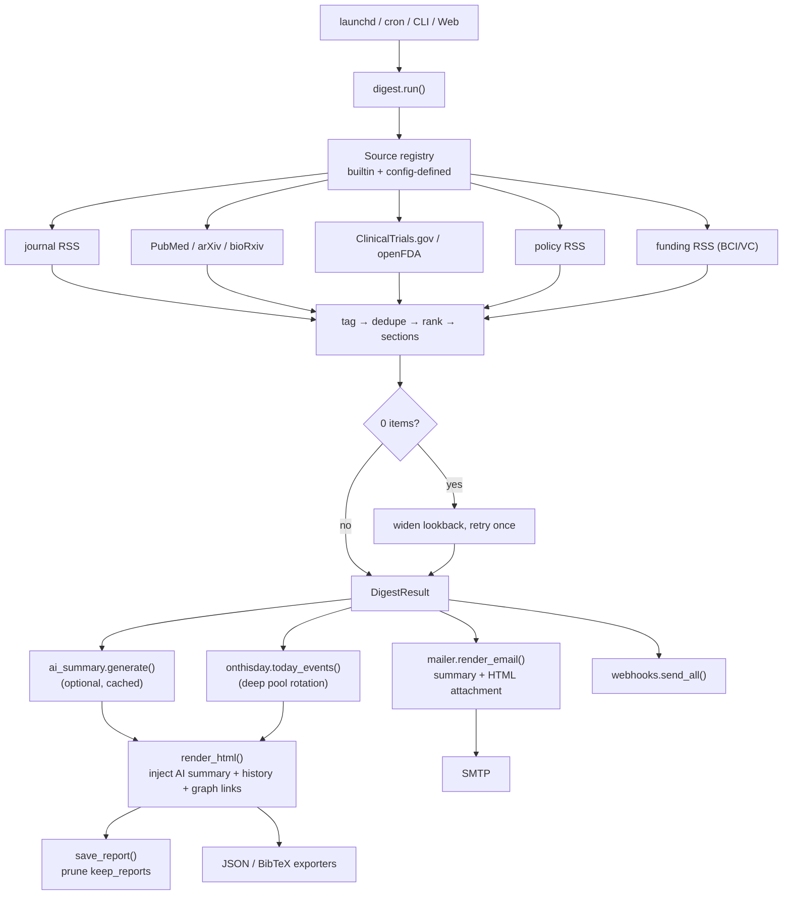

# 架构说明

> **中文** — 架构、数据流、模块职责与扩展点。
> **English** — Architecture, data flow, module responsibilities and extension points.
> **Русский** — Архитектура, поток данных, обязанности модулей и точки расширения.

> [中文](ARCHITECTURE.md) · [English](en/ARCHITECTURE.md) · [Русский](ru/ARCHITECTURE.md)

> 目标：**一台机器、一次部署、每天自动产出可读日报**；所有环节可降级，任何单点失败都不应让整份报告消失。

## 1. 总览

## 2. 数据流（一次 run）

1. **加载配置**：`Config.load(path)`；`--profile` 时路径为 `config/profiles/<name>.json`。
2. **构建源注册表**：`sources.registry_for(config)` = 8 个内置源 + 配置里 `type: rss|json_api` 的源。
3. **并行抓取**：`ThreadPoolExecutor`（最多 8 并发），每源独立计时、独立失败。
4. **0 条回退**：若全部源为空，自动把各源 `lookback_days` 放宽到 ≥7 再跑一次。
5. **加工**：`tag_items()` 打学科/关键词标签 → 按 URL/标题去重 → 按「顶刊 → 同行评审 → 预印本 → 日期」排序 → 按 `kind` 分板块。
6. **附加内容**：AI 摘要（可选，缓存）、历史上的今天（深读池按日轮换）。
7. **渲染**：Jinja2 模板 → 注入 AI 摘要（最顶）→ 历史上的今天 → 图谱 JS。
8. **落盘**：`output/neurodaily_<时间>.html`；可选 JSON/BibTeX；按 `keep_reports` 裁剪。
9. **投递**：邮件（SMTP）、Webhook（飞书/企微）、桌面通知。
10. **记录**：`output/search_history.db` 记录每次运行的源计数、条数、报告路径。

## 3. 模块职责

| 模块 | 职责 | 关键点 |
|---|---|---|
| `cli.py` | 命令解析与编排 | `run/serve/config/profile/mail/export/ai-summary/demo/webhook/deepen/launchd/history` |
| `config.py` | 配置 dataclass、load/save/to_dict | `Config.from_dict` 无损往返 |
| `config_ops.py` | 合并补丁、profile、schema 导出 | Agent 配置协议 |
| `schema.py` | pydantic 校验 | 字段路径错误 |
| `digest.py` | 抓取编排、标签、去重、板块、落盘 | 并行、0 条回退、裁剪 |
| `models.py` | `Item` 数据模型、kind/label、标签 | 所有源统一输出 `Item` |
| `sources/` | 各数据源 + 通用 RSS/JSON | `registry_for()` 动态注册 |
| `onthisday.py` | 975 条里程碑、936 篇长文、按日轮换 | mtime 热加载缓存 |
| `deepen.py` | 长文批量扩写（LLM/模板） | 缓存、重试、断点续跑 |
| `ai_summary.py` | 每日 AI 综述 | 指纹缓存、失败降级 |
| `render.py` | HTML 渲染 + 注入 | AI/史论/图谱注入顺序 |
| `mailer.py` | 邮件渲染/发送 | 摘要正文 + 附件、重试 |
| `mail_tui.py` | 收件人/SMTP 凭据 TUI | 隐藏输入、600 权限 |
| `webhooks.py` | 飞书/企微 | 失败不影响主流程 |
| `exporters.py` | JSON / BibTeX | 数据可带走 |
| `demo.py` | 离线演示数据 | 断网可演示 |
| `webapp.py` | FastAPI 仪表盘/设置/API | 配置校验、profile 支持 |
| `settings_page.py` | 设置页 HTML/JS | 原生 JS，无新依赖 |
| `history.py` | SQLite 运行历史 | 报告路径关联 |

## 4. 扩展点

### 4.1 数据源

- **内置**：实现 `fetch(config, logger=None) -> list[Item]`，在 `sources/__init__.py` 的 `BUILTIN` 注册。
- **配置化**：`sources.<name> = {"type":"rss"|"json_api", ...}`，无需改代码。
- **未来**：`entry_points("neurodaily.sources")` 支持第三方插件（已预留设计，未实现）。

### 4.2 板块

当前固定 4 个板块（papers / industry / trials_conferences / policy），由 `digest._SECTION_BY_KIND` 映射。
`kind` 已扩展到 `funding`（映射到 industry）。
**未来**：section 注册表 + 模板遍历（见 `competition/可定制化与可拓展性优化.md`）。

### 4.3 渲染

`render.py` 采用「模板 + 字符串注入」：
- `_inject_ai_summary`：AI 摘要置顶
- `_inject_on_this_day`：历史上的今天
- `_inject_graph_links`：每篇文末「🕸 图谱」下拉

注入顺序决定版块顺序：AI → 史论 → 正文。

### 4.4 LLM

`ai_summary.py` / `deepen.py` 均通过 **OpenAI 兼容** `/chat/completions` 调用：
- `base_url` 可指向 DeepSeek、豆包、SJTU 网关、Ollama（`http://127.0.0.1:11434/v1`）等。
- 提示词内置「不得编造日期/数字/人名」约束。
- 结果缓存，按内容指纹失效。

### 4.5 输出

HTML（必有）+ 邮件 + JSON/BibTeX（`output.extra_formats`）+ Webhook。
所有输出失败均为**警告级**，不影响主报告。

## 5. 失败与降级

| 环节 | 失败时 |
|---|---|
| 单个数据源 | 记 `failed`，其余继续，报告底部显示 Source Health |
| 全部源为空 | 放宽 lookback 重试一次；仍空则报告注明 |
| AI 摘要 | 跳过并打印警告，报告照常 |
| 邮件 | 打印警告，报告照常；无收件人/无密码明确报错 |
| Webhook | 记录失败原因，不影响其它渠道 |
| 导出 | 忽略，主报告已生成 |
| 配置非法 | `config apply` 拒绝写入；Web 保存返回 400 + 字段错误 |

## 6. 数据与存储

| 路径 | 内容 | 是否入库 |
|---|---|---|
| `config/config.json` | 主配置 | 否（gitignore） |
| `config/profiles/*.json` | 学科 profile | 否 |
| `config/email.json`、`config/ai_summary.json`、`config/webhooks.json` | 投递/AI 配置 | 否 |
| `~/.neurodaily_smtp`、`~/.neurodaily_llm` | 凭据（600） | 否 |
| `output/*.html` | 日报 | 否 |
| `output/search_history.db` | 运行历史 | 否 |
| `output/ai_summary/*.json` | AI 摘要缓存 | 否 |
| `neurodaily/data/onthisday_deep.json` | 长文缓存（936 篇） | **是**（可复现内容） |

## 7. 安全模型

- Web 应用默认只绑 `127.0.0.1`；Docker 内绑 `0.0.0.0`（由端口映射控制暴露面）。
- 凭据仅存本机 600 权限文件或环境变量；仓库内只有占位符。
- 提交前钩子（`scripts/install_git_hooks.sh`）阻断 `@qq.com`、非占位符 `@sjtu.edu.cn`、`sk-` token。
- `/reports/{filename}` 使用 `basename` 防路径穿越。
- 仅聚合公开元数据，不存全文、不绕付费墙。

## 8. 性能

- 源并行抓取（最慢源决定总时长，约 1–3 分钟）。
- AI 摘要/长文均缓存，重复运行不重复计费。
- 历史报告裁剪（默认保留 60 份），避免磁盘无限增长。
